# Accès mobile — maquettes des trois écrans (#335)

Prototype jetable : branche **non destinée au merge**. Données fictives, aucun backend, aucun lancement d’Orchestra.

- 3 variantes × 7 écrans, 390×844 @3x (iPhone), FR.
- Reconstruire : `node build.mjs && node shoot.mjs` (Chromium headless piloté en CDP, aucune fenêtre).
- Polices : Geist / Inter / JetBrains Mono (OFL, copiées de `src/renderer/assets/fonts/`). Sur l’iPhone, Inter ≈ SF Pro.
- Tokens de départ : `docs/codebase-map/agent-view-design.md` (`--av-*`) ; V2 reprend l’accent clair `#2f6fe0`.

## V1 · Boîte de réception

dark, look du bureau. « À traiter » épinglé en tête (en attente puis non lu), le reste groupé par repo. Conversation = document (réponses pleine largeur, outils sur une ligne), question en carte dans le flux. Densité moyenne.

| Liste · tout | Liste · à traiter | Question | Élicitation | Composer | Envoi échoué | Injoignable |
|---|---|---|---|---|---|---|
| 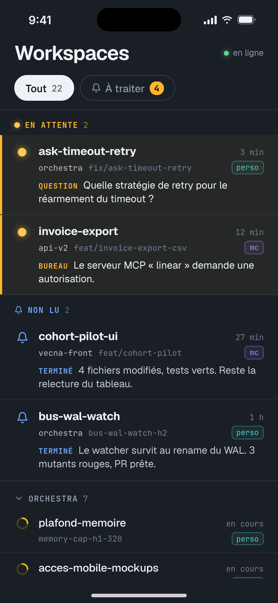 | 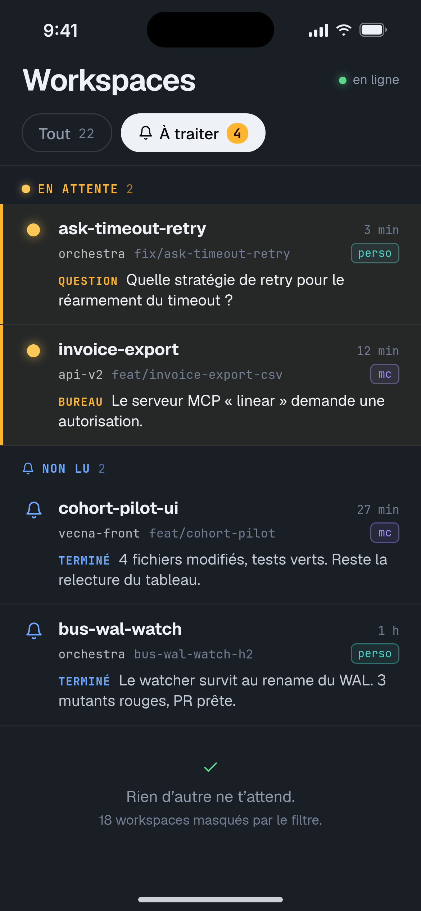 | 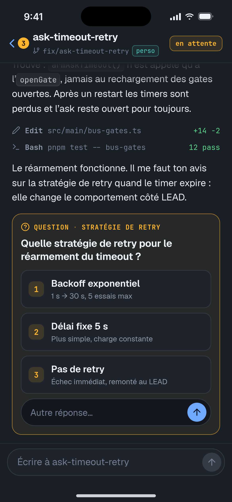 | 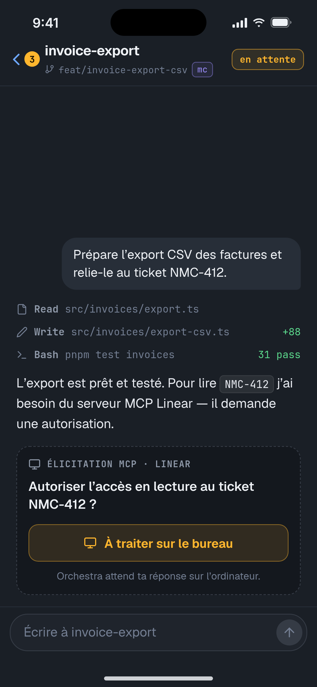 | 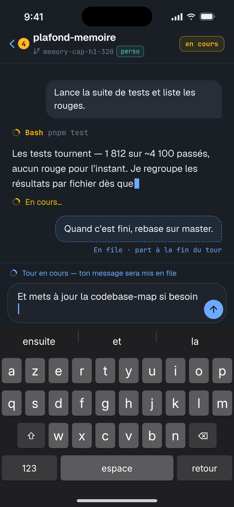 | 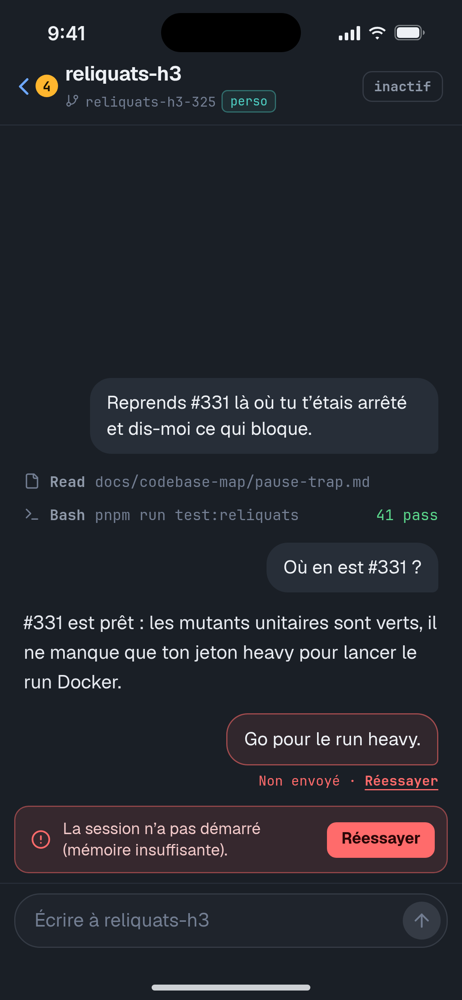 | 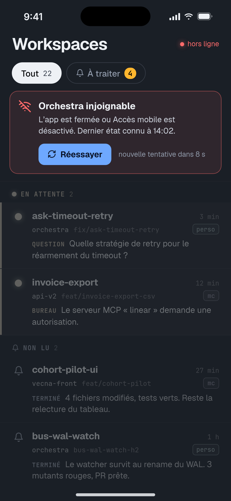 |

## V2 · Messages

clair, ressenti app iOS. Onglets À traiter / Tous ; les cartes en attente portent les boutons de réponse (réponse rapide sans ouvrir). Conversation en bulles, « injoignable » en plein écran. Aéré, gros doigts.

| Liste · tout | Liste · à traiter | Question | Élicitation | Composer | Envoi échoué | Injoignable |
|---|---|---|---|---|---|---|
| 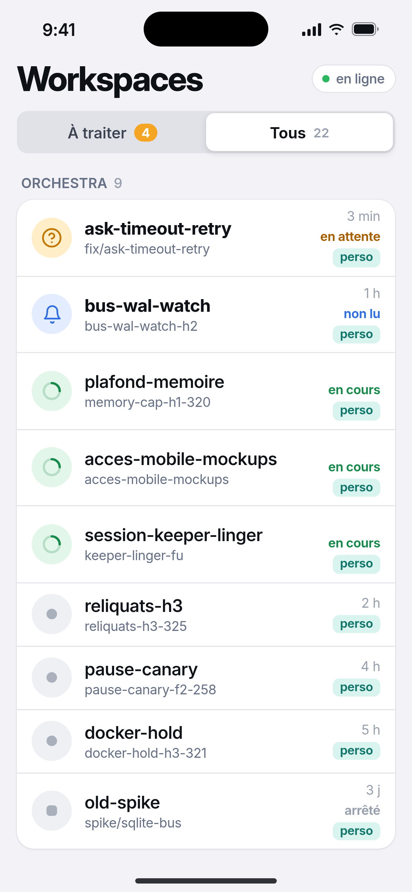 | 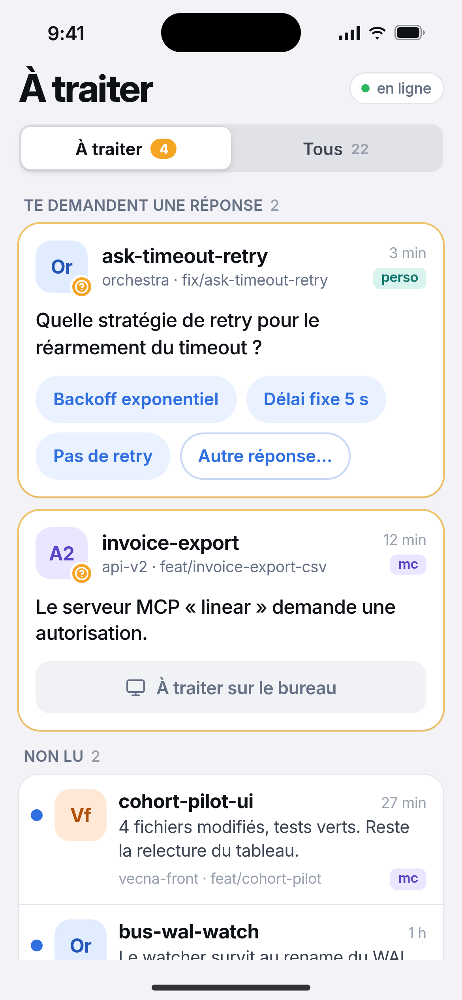 | 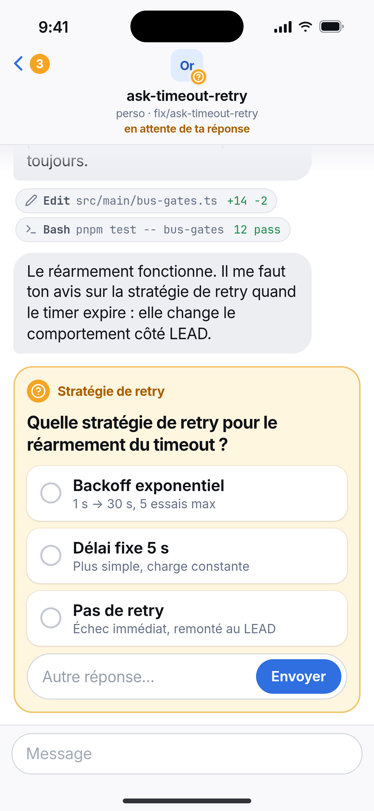 | 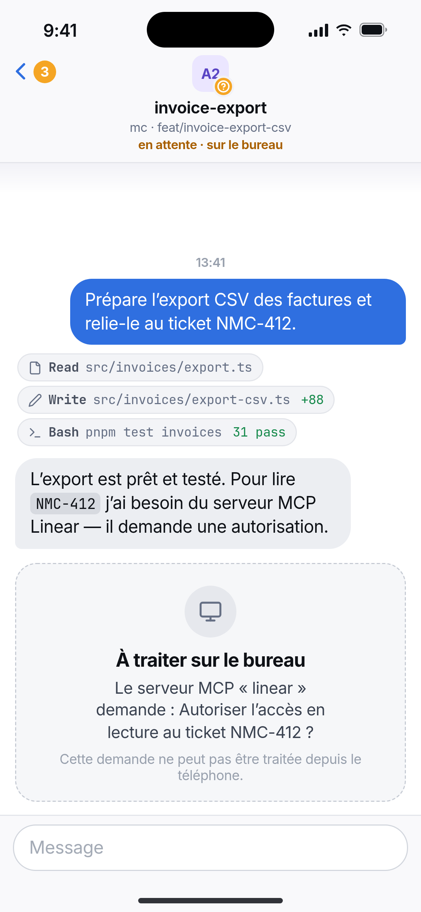 | 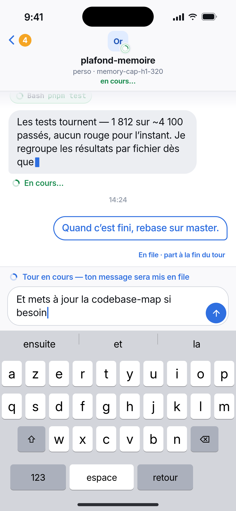 | 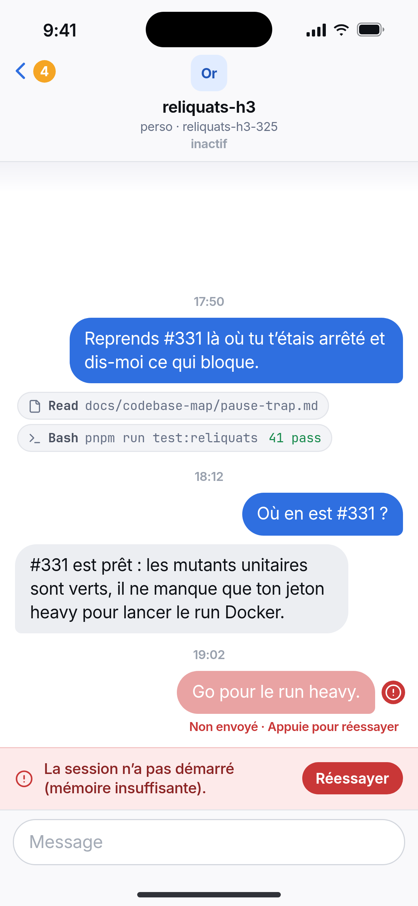 | 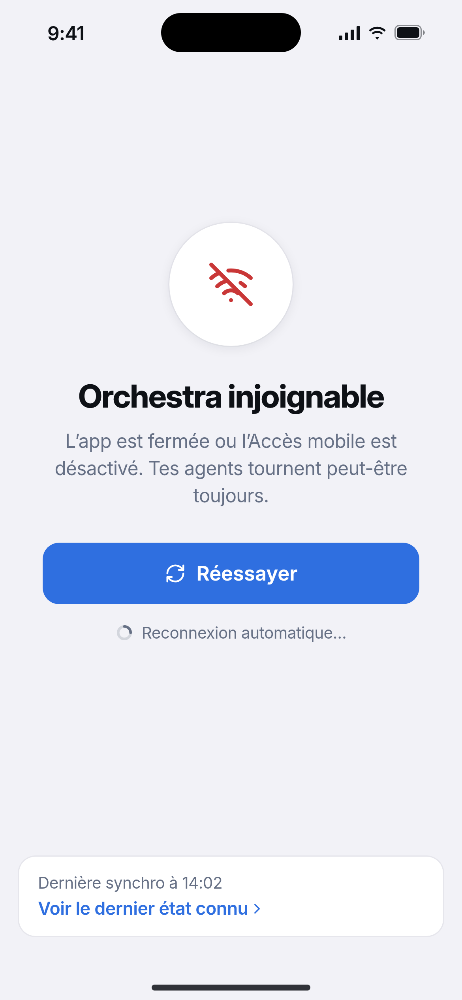 |

## V3 · Console

noir OLED, très dense, chrome mono. Arbre par repo avec compteurs : repos urgents ouverts, le reste replié en une ligne. Transcript à rail, question en bottom sheet sous le pouce. Plus d’info par écran, moins de confort.

| Liste · tout | Liste · à traiter | Question | Élicitation | Composer | Envoi échoué | Injoignable |
|---|---|---|---|---|---|---|
| 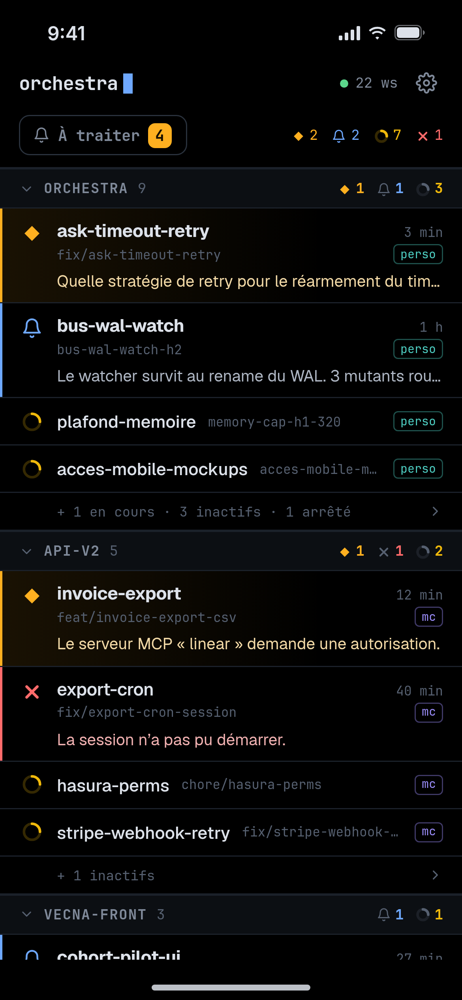 | 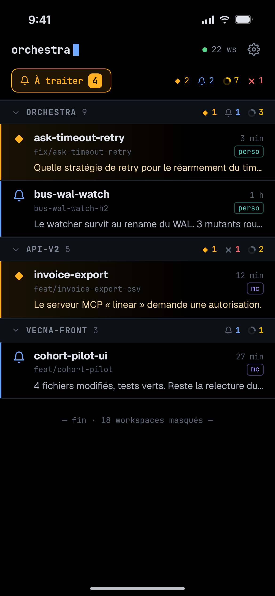 | 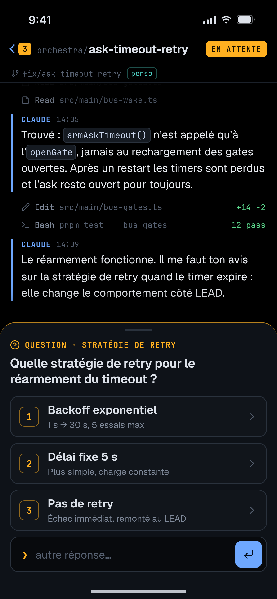 | 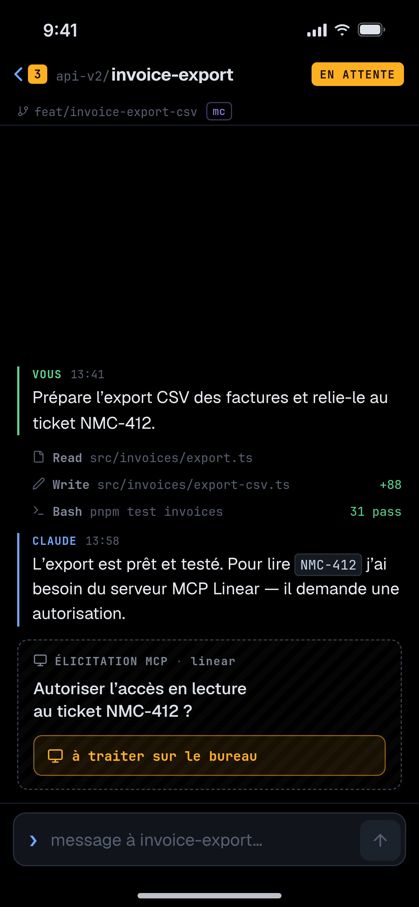 | 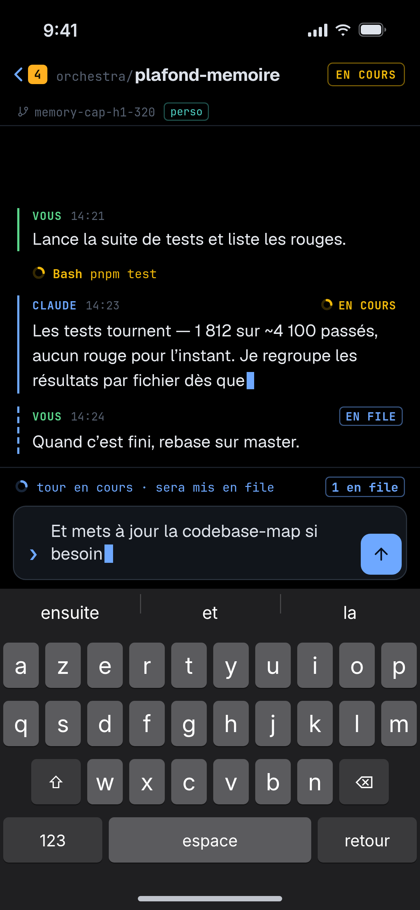 | 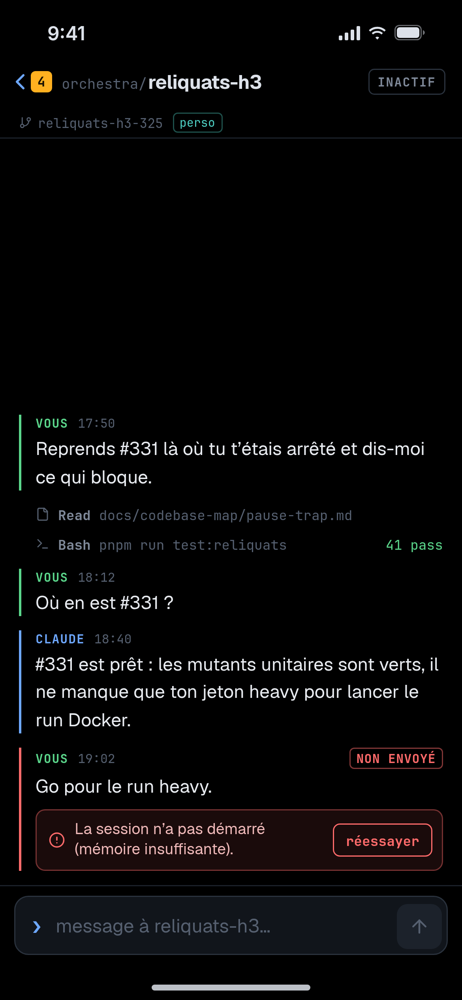 | 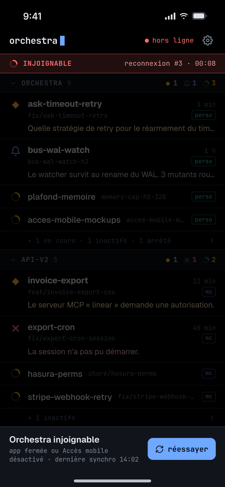 |
